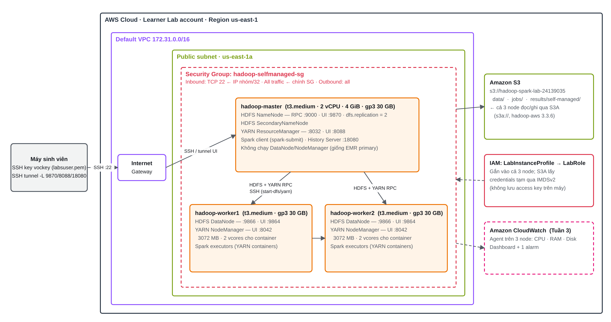

# Kiến trúc cụm Hadoop/Spark tự dựng trên EC2 (nhánh Self-managed)

**Người phụ trách:** Đỗ Minh Hiển (24139013) · **Tuần 1 (19/10–25/10/2026)**
**Sơ đồ:** [`diagrams/self-managed-architecture.png`](diagrams/self-managed-architecture.png). Bản sửa được là `self-managed-architecture.drawio`, mở bằng draw.io / diagrams.net. Cả hai được sinh từ `make_self_managed_diagram.py`.



---

## 1. Kiến trúc Hadoop 3 và Spark-on-YARN

### HDFS: lưu trữ phân tán
| Thành phần | Vai trò | Ở cụm này |
|---|---|---|
| **NameNode** | Giữ metadata, gồm cây thư mục, danh sách block của từng file và vị trí từng block trên DataNode. Không chứa dữ liệu. Client hỏi NameNode trước, rồi đọc/ghi thẳng với DataNode. | `hadoop-master`, RPC `:9000` (`fs.defaultFS=hdfs://hadoop-master:9000`), UI `:9870` |
| **SecondaryNameNode** | Định kỳ gộp `fsimage` + `edits` thành checkpoint để NameNode khởi động lại nhanh. **Không phải** bản dự phòng HA. | `hadoop-master` |
| **DataNode** | Lưu block (mặc định 128 MB) trên đĩa cục bộ, gửi heartbeat và block report về NameNode. | `hadoop-worker1`, `hadoop-worker2`, port dữ liệu `:9866` |

Có 2 DataNode nên `dfs.replication = 2`. Mặc định là 3, nhưng với 2 node thì block sẽ luôn ở trạng thái under-replicated.

### YARN: quản lý tài nguyên
| Thành phần | Vai trò | Ở cụm này |
|---|---|---|
| **ResourceManager** | Gồm Scheduler (cấp container theo RAM/vCPU) và ApplicationsManager (nhận job, khởi động ApplicationMaster). | `hadoop-master`, `:8032`, UI `:8088` |
| **NodeManager** | Chạy container trên từng máy, báo tài nguyên còn trống về RM. | 2 worker, UI `:8042` |
| **ApplicationMaster** | Mỗi ứng dụng có 1 AM, chạy trong container, xin thêm container từ RM. Với Spark thì AM chính là driver (cluster mode) hoặc một AM nhỏ (client mode). | trên worker |

### Spark-on-YARN
- `spark-submit --master yarn` gửi ứng dụng lên RM. Executor của Spark là các **YARN container** trên NodeManager.
- **client mode:** driver chạy ngay trên máy gõ lệnh (master), tiện debug.
- **cluster mode:** driver chạy trong AM container trên worker. **EMR Step mặc định dùng cluster mode**, nên lúc benchmark cả hai cụm sẽ dùng `--deploy-mode cluster` để so sánh công bằng.
- Đọc/ghi S3 qua connector **S3A** (`s3a://…`). Credentials lấy từ instance profile qua IMDSv2, nên không ghi access key vào file cấu hình.

## 2. Thiết kế cụm

| Node | Loại | Tiến trình | Đĩa |
|---|---|---|---|
| `hadoop-master` | t3.medium (2 vCPU, 4 GiB, burstable) | NameNode, SecondaryNameNode, ResourceManager, Spark client, History Server | gp3 30 GB |
| `hadoop-worker1` | t3.medium | DataNode, NodeManager, Spark executors | gp3 30 GB |
| `hadoop-worker2` | t3.medium | DataNode, NodeManager, Spark executors | gp3 30 GB |

Master **không** chạy DataNode/NodeManager. Như vậy topology giống EMR (primary node chỉ điều phối, core node làm việc), đúng giao thức "1 master + 2 worker" ở cả hai cụm.

**Mạng**
- Default VPC `172.31.0.0/16`, cả 3 node chung một public subnet ở **us-east-1a**. Dùng một AZ để giảm độ trễ và tránh phí truyền dữ liệu liên AZ. Không chọn us-east-1e vì AZ này không có t3.
- `/etc/hosts` dùng **private IP**. Private IP giữ nguyên qua Stop/Start, còn public IP thì đổi mỗi lần Start hoặc khi hết phiên lab. Public IP chỉ dùng để SSH từ ngoài vào.
- Lưu lượng tới S3 đi qua Internet Gateway, vì default VPC chưa có S3 Gateway Endpoint. Có thể thêm endpoint ở Tuần 3 (CloudFormation) nếu Learner Lab cho phép.

**Security Group `hadoop-selfmanaged-sg`**
| Chiều | Giao thức/cổng | Nguồn | Lý do |
|---|---|---|---|
| Inbound | TCP 22 | IP của nhóm `/32` | SSH quản trị |
| Inbound | All | chính SG này | HDFS/YARN/Spark dùng nhiều cổng động giữa các node |
| Outbound | All | 0.0.0.0/0 | tải gói, S3, CloudWatch |

Không mở `9870/8088/18080` ra Internet. Xem UI qua SSH tunnel:
```bash
ssh -i labsuser.pem -N -L 9870:hadoop-master:9870 -L 8088:hadoop-master:8088 -L 18080:hadoop-master:18080 ec2-user@<MASTER_PUBLIC_IP>
```

**IAM:** cả 3 node gắn `LabInstanceProfile` (role `LabRole` có sẵn trong Learner Lab, không tạo IAM mới).
**Tag:** `Project=HadoopSpark-EC2-vs-EMR`, `Owner=24139013`, `Cluster=hadoop-selfmanaged`, `Role=master|worker`, `Name=<hostname>`. Tag gắn cho instance, EBS volume và Security Group.

**Phần mềm**
| Thành phần | Phiên bản | Ghi chú |
|---|---|---|
| OS | Amazon Linux 2023 (x86_64) | user `ec2-user`, có sẵn AWS CLI |
| Java | Amazon Corretto 11 (bản build OpenJDK 11) | Hadoop 3.3 hỗ trợ Java 8/11 |
| Hadoop | 3.3.6 | `/opt/hadoop` |
| Spark | 3.5.5 **bin-without-hadoop** | `/opt/spark`, `SPARK_DIST_CLASSPATH=$(hadoop classpath)` |
| S3A (Tuần 2) | `hadoop-aws-3.3.6` + `aws-java-sdk-bundle-1.12.367` | phải cùng phiên bản với Hadoop |

*Vì sao chọn Spark "without-hadoop":* bản `spark-*-bin-hadoop3` đóng gói sẵn hadoop-client 3.3.4. Nếu ghép thêm `hadoop-aws-3.3.6` sẽ lệch phiên bản và dễ gặp `NoSuchMethodError`/`ClassNotFoundException` khi đọc `s3a://`. Bản without-hadoop dùng chính Hadoop 3.3.6 đã cài nên chỉ còn một bộ thư viện.

## 3. Ngân sách bộ nhớ (bản nháp, chỉnh ở Tuần 2)

t3.medium có 4 GiB. Trên mỗi worker, OS + DataNode + NodeManager chiếm khoảng 1 GiB, phần còn lại dành cho container:

| Tham số | Giá trị dự kiến |
|---|---|
| `yarn.nodemanager.resource.memory-mb` | 3072 |
| `yarn.nodemanager.resource.cpu-vcores` | 2 |
| `yarn.scheduler.minimum-allocation-mb` / `maximum-allocation-mb` | 512 / 3072 |
| `yarn.nodemanager.vmem-check-enabled` | false (tránh container bị kill oan do virtual memory) |
| `spark.executor.memory` + overhead | 1g + 384m, làm tròn thành container 1536 MB |
| `spark.executor.cores` | 1 |
| `spark.driver.memory` (cluster mode) | 1g, nằm trong 1 container 1536 MB |

Tổng 6144 MB container. Trong cluster mode, driver/AM chiếm 1 container 1536 MB, còn lại **3 executor × 1 core**. Con số này sẽ đo lại và tối ưu ở Tuần 4.

## 4. Các bước dựng (Tuần 1)

Chạy trong **AWS CloudShell (us-east-1)** hoặc trên laptop đã có AWS CLI và credentials của phiên Learner Lab:

```bash
git clone https://github.com/lhuynhu06-beep/DTDM.git && cd DTDM
# 0) Báo Như trong nhóm chat: "Hiển bật cụm EC2 từ hh:mm"
./infra/ec2-cluster.sh up                      # SG + 3 EC2 (tag, LabInstanceProfile, gp3 30 GB) → infra/cluster.env
KEY=~/labsuser.pem ./scripts/bootstrap-cluster.sh   # setup-base.sh trên 3 node song song + SSH không mật khẩu
./infra/ec2-cluster.sh status                  # ảnh minh chứng
./infra/ec2-cluster.sh stop                    # cuối buổi
```

`scripts/setup-base.sh <hostname>` chạy trên từng node và làm các việc sau: đặt hostname, ghi `/etc/hosts`, cài Java 11, tải Hadoop/Spark (có kiểm tra SHA-512), ghi biến môi trường và tạo SSH key trên master. Script chạy lại nhiều lần không gây lỗi. Nếu thiếu `cluster.env`, script tự tìm IP các node qua tag bằng AWS CLI và quyền của LabRole. Nhờ đó, script dùng lại được làm user-data cho template CloudFormation ở Tuần 3.

**Lưu ý:** sau mỗi lần Start lại cụm (nhất là sau khi phiên lab hết hạn), chạy `./infra/ec2-cluster.sh env` để cập nhật public IP. `/etc/hosts` trên các node không cần sửa.

## 5. Rủi ro và việc cần thống nhất với Như

1. **Bucket S3 nằm ở tài khoản nào?** `s3://hadoop-spark-lab-24139035` do Như tạo. Nếu hai bạn dùng **hai tài khoản Learner Lab khác nhau**, `LabRole` của cụm EC2 sẽ **không đọc được** bucket này. Có hai cách:
   - (a) Như thêm bucket policy cho phép `arn:aws:iam::<Account-ID-của-Hiển>:role/LabRole` gọi `s3:GetObject`, `s3:ListBucket` và `s3:PutObject` (giới hạn ở `results/self-managed/*`).
   - (b) Hiển tạo bucket riêng có tag, rồi chép `data/` và `jobs/` sang.

   Tương tự, quy định "không chạy đồng thời 2 cụm" chỉ thực sự cần thiết khi hai cụm chạy chung một tài khoản, vì giới hạn 9 instance / 32 vCPU tính theo từng tài khoản và Region.
2. **Kích thước dữ liệu:** hiện bucket chỉ có `Chí Phèo.txt`, cỡ vài trăm KB. Giao thức benchmark cần khoảng 1 / 3 / 5 GB. Có thể nhân bản và ghép thêm corpus, nhưng nên ghi rõ trong báo cáo.
3. **Job aggregation** đọc CSV có header. Cần một bộ dữ liệu CSV riêng, không dùng file `.txt`.
4. **t3 là CPU burstable:** benchmark dài có thể hết CPU credit. Cần ghi lại `CPUCreditBalance` trên CloudWatch và nêu điều này khi so với m4.large (CPU cố định, 8 GiB).
5. **Phiên Learner Lab khoảng 4 giờ:** hết phiên thì EC2 bị Stop và credentials CLI đổi. Không để job dài chạy sát giờ hết phiên.
